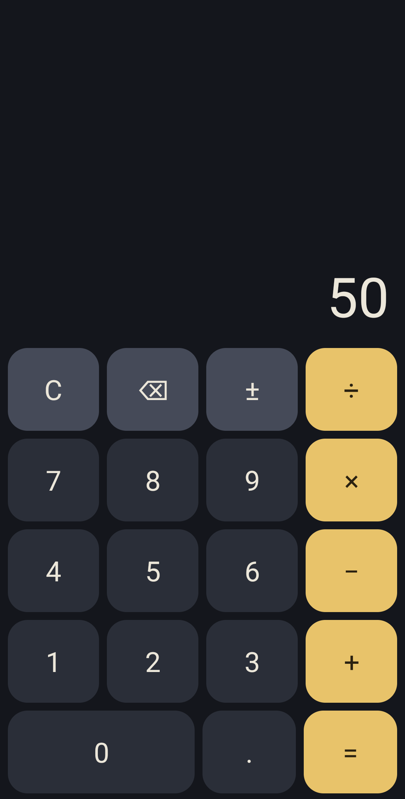

# Build an Android app in Eiffel, from nothing to a phone

This guide takes you from an empty folder to a calculator running on an Android phone. You write Eiffel and nothing else: no Java, no Kotlin, no XML layouts, no Gradle.

The finished app is this repository, so every step can be checked against working code. It is small on purpose: about 240 lines of screen and 360 lines of logic, and the whole APK is under a megabyte.



**You should already know** the basics of Eiffel: classes, features, and what `require` and `ensure` mean. You do not need to know anything about Android.

**You will learn to:**

- split an app into logic you can test on a PC and a thin screen on top
- use Design by Contract in a phone app, and read a broken contract in the phone's log
- lay out a screen from Eiffel with Android's own controls
- build, install and debug with one tool, `eifphone`
- test at the font size real people use
- sign a release

## 1. How it works

`eifphone` turns an Eiffel project into a signed APK. It does this in stages, and you will see each one go by when you build:

1. **Gobo's `gec` compiles your Eiffel to C.**
2. **The Android NDK's `clang` compiles that C** to a native library, once for each processor type.
3. **A small fixed Java helper** that ships with the library is compiled to `classes.dex`. You never touch it.
4. **The Android tools package, align and sign** the APK.

At run time your Eiffel owns the app. When you create a `PHONE_BUTTON`, Eiffel sends an order across to Android, and Android makes a real Android control. When someone taps it, the tap comes back to Eiffel as an event, and your agent runs. So the app looks and feels native, because it is: these are Android's own controls, with Android's own keyboard, accessibility and press effects.

## 2. What you need

You need a Windows PC. The tool runs on Windows only. Your app runs on Android 8.0 or later.

| Tool | Version | Used for |
|---|---|---|
| EiffelStudio | 25.02 | Compiling the tests on the PC, and its Eiffel base library |
| Gobo `gec` | 26.10 | Compiling Eiffel for the phone |
| Android SDK | build-tools 36.0.0, platform android-36, platform-tools | Packaging and installing |
| Android NDK | 30.0.16248370 | Compiling C for the phone |
| A JDK | 17 or later | Compiling the Java helper, signing |
| `git` | any | Getting the libraries |

If you have Android's `sdkmanager`, this gets the Android parts:

```
sdkmanager "ndk;30.0.16248370" "build-tools;36.0.0" "platforms;android-36" "platform-tools"
```

Then tell the tool where everything is. These are the standard names:

```
set ANDROID_HOME=C:\android\sdk
set ANDROID_NDK_HOME=C:\android\sdk\ndk\30.0.16248370
set JAVA_HOME=C:\Program Files\Java\jdk-17
set GOBO=C:\gobo
set ISE_LIBRARY=C:\Program Files\Eiffel Software\EiffelStudio 25.02 Standard
```

The paths are examples. Use your own.

## 3. Get the libraries and the tool

Pick one folder to hold the Simple Eiffel libraries, and name it in `SIMPLE_EIFFEL`:

```
mkdir C:\simple
set SIMPLE_EIFFEL=C:\simple
cd C:\simple
git clone https://github.com/simple-eiffel/simple_eif_phone
git clone https://github.com/simple-eiffel/simple_mml
git clone https://github.com/simple-eiffel/simple_testing
```

`simple_eif_phone` is the phone library. `simple_mml` is what it stands on. `simple_testing` is only for the tests on the PC.

Now get the tool. Download `eifphone.exe` from the [latest release](https://github.com/simple-eiffel/simple_eif_phone/releases/latest), put it in a folder on your `PATH`, and ask it what it can find:

```
eifphone doctor
```

It lists each tool it needs, and ends with:

```
doctor: all tools found
```

If it names something missing, fix that before you go on. Every later problem is easier once this line is clean.

## 4. Start the project

`eifphone` can start a project for you:

```
eifphone new simple_phone_calc --id io.github.me.phonecalc --label "Phone Calc"
```

That writes a small working app that paints the screen. This guide uses Android's controls instead, so here is the layout we are heading for:

```
simple_phone_calc/
    eifphone.toml             what the tool needs to know
    simple_phone_calc.ecf     how to compile it
    icon/ic_launcher.png      the icon on the phone
    src/engine/calc_engine.e  the calculator: no phone in sight
    src/app/calc_app.e        the screen
    testing/                  tests, run on the PC
```

### eifphone.toml

```toml
[app]
id = "io.github.simple_eiffel.phonecalc"
label = "Phone Calc"
version_code = 1
version_name = "1.0.0"
icon = "icon/ic_launcher.png"

[eiffel]
ecf = "simple_phone_calc.ecf"
target = "simple_phone_calc"

[android]
abis = ["arm64-v8a", "x86_64"]
min_sdk = 26
target_sdk = 36
controls = true
orientation = "portrait"
```

Line by line, the ones that matter:

- **`id`** is your app's name to Android. It must be unique on the phone, and you should never change it once people have the app. Use a domain you control, turned around.
- **`label`** is the name under the icon.
- **`version_code`** must go up with each release you hand out. `version_name` is what people see.
- **`abis`** are processor types. `arm64-v8a` is nearly every real phone. `x86_64` is the emulator. Keep both.
- **`controls = true`** says this app uses Android's own controls. Without it, you get a bare window to draw on.
- **`orientation`** holds the screen upright, because five rows of keys will not fit sideways. Leave it out and the app turns with the phone.

### The ECF

The ECF has two targets, and that is the heart of the design:

```xml
<target name="simple_phone_calc">
    <root class="CALC_APP" feature="make"/>
    ...
    <library name="base" location="$ISE_LIBRARY\library\base\base.ecf"/>
    <library name="simple_eif_phone" location="$SIMPLE_EIFFEL\simple_eif_phone\simple_eif_phone.ecf"/>
    <cluster name="engine" location=".\src\engine\"/>
    <cluster name="app" location=".\src\app\"/>
</target>
<target name="simple_phone_calc_tests">
    <root class="TEST_APP" feature="make"/>
    ...
    <library name="base" location="$ISE_LIBRARY\library\base\base.ecf"/>
    <library name="simple_testing" location="$SIMPLE_EIFFEL\simple_testing\simple_testing.ecf"/>
    <library name="testing" location="$ISE_LIBRARY\library\testing\testing.ecf"/>
    <cluster name="engine" location=".\src\engine\"/>
    <cluster name="tests" location=".\testing\"/>
</target>
```

The app target has the engine, the screen and the phone library. It is only ever compiled for the phone. The test target has the engine and the tests, and **no phone library at all**, so it compiles and runs on your PC in seconds.

The app target also sets `console_application` and turns all the assertions on. Keep them on while you develop. See section 10.

## 5. The engine: a calculator with no screen

Write the logic first, in a class that has never heard of a phone. `CALC_ENGINE` knows what each key does and what the display should say. That is all. See `src/engine/calc_engine.e`.

Its public face is a few queries and one command for each key:

```eiffel
display: STRING_32
        -- What the calculator shows.

pending_operator: INTEGER
        -- The operator waiting for its second number.

is_in_error: BOOLEAN
        -- Is the calculator showing an error? Only `press_clear' may follow.
```

### Contracts say the rules out loud

Here is the key for a digit:

```eiffel
press_digit (a_digit: INTEGER)
        -- Add `a_digit' to the number being typed, or start a new one.
    require
        a_digit_valid: a_digit >= 0 and a_digit <= 9
        not_in_error: not is_in_error
    do
        ...
    ensure
        typing: is_typing
        operator_unchanged: pending_operator = old pending_operator
    end
```

The `require` clause is a rule for the caller: you may press a digit, but only a real digit, and not while an error is showing. The `ensure` clause is the engine's promise back. `operator_unchanged` says that typing a digit never disturbs a sum in progress, and `old` is how you talk about the value before the call.

The class also keeps promises at all times, in its invariant:

```eiffel
invariant
    display_exists: not display.is_empty
    operator_known: pending_operator = Op_none or is_operator (pending_operator)
    error_ends_the_sum: is_in_error implies pending_operator = Op_none
```

The display is never blank, and an error never leaves a sum half done. These are checked at run time, on the phone as well as on your PC.

### Why 0.1 + 0.2 shows 0.3

A `REAL_64` cannot hold 0.1 exactly, so 0.1 + 0.2 comes out as 0.30000000000000004. A calculator that showed that would be laughed at. The answer is to round when you show a number, not when you hold it. `text_of` keeps twelve significant digits and drops trailing zeros:

```eiffel
l_scaled := (a_value.abs * l_scale.to_double + 0.5).truncated_to_integer_64
l_whole := l_scaled // l_scale
l_fraction := l_scaled \\ l_scale
```

Numbers of a trillion and up show "Too large", so that this arithmetic always fits in an `INTEGER_64`. That limit is a precondition of `text_of` too: `fits: a_value.abs < Largest`.

## 6. Test it on the PC

Tests press keys and read the display, exactly as a person would. From `testing/lib_tests.e`:

```eiffel
test_point_one_plus_point_two
    local
        e: CALC_ENGINE
    do
        e := new_engine
        e.press_point
        e.press_digit (1)
        e.press_operator (e.Op_add)
        e.press_point
        e.press_digit (2)
        e.press_equals
        shows ("no noise", e, "0.3")
    end
```

Compile and run them. From the project folder, in EiffelStudio's command line tools:

```
ec -batch -config simple_phone_calc.ecf -target simple_phone_calc_tests -finalize -keep -c_compile
EIFGENs\simple_phone_calc_tests\F_code\simple_phone_calc.exe
```

`-keep` keeps the contracts switched on in a finalized build. You should see 26 lines of `PASS`, and then:

```
Results: 26 passed, 0 failed
ALL TESTS PASSED
```

Get this right before you go near a phone. A test here takes a moment. A test on a phone takes a build and an install.

One test is worth a look, because the contract itself is what it tests. `test_contract_guards_error` presses a digit during an error, and passes only if the precondition refuses it.

## 7. The screen

Now the phone. `CALC_APP` is the root class, and it does three things: build the controls, show them, and hand over to the phone.

```eiffel
make
        -- Build the screen, then hand over to the phone until it ends the app.
    local
        l_screen: PHONE_COLUMN
    do
        create phone.make
        controls := phone.controls
        create engine.make
        create display.make (controls, engine.display)
        create l_screen.make (controls)
        l_screen.set_surface (Background, 0)
        l_screen.set_spacing (Gap, Gap)
        build_display (l_screen)
        build_keys (l_screen)
        controls.show (l_screen)
        phone.run_controls
    end
```

- **`SIMPLE_EIF_PHONE`** is the phone: its life, its screen, its log. Make exactly one.
- **`PHONE_CONTROLS`** makes and shows Android's controls.
- **`phone.run_controls`** is the event loop. It returns only when Android ends the app. Everything after this happens in your agents.

### Layout

Layout is boxes inside boxes. `PHONE_COLUMN` stacks its children down the screen, and `PHONE_ROW` lines them up across. Each has two ways to add a child:

- **`extend`** gives the child its natural size.
- **`extend_growing (child, share)`** gives it a share of the room left over.

That is enough for the whole screen. The rows of keys are added with `extend`, so they keep their size. The display is added with `extend_growing`, so it takes everything the keys leave, on any size of phone:

```eiffel
a_screen.extend_growing (display, 1)
```

Inside each row, the keys share the width by the same rule. The `0` key has a share of 2 and the rest have 1, which is why it is twice as wide.

### One key

```eiffel
add_key (a_row: PHONE_ROW; a_text: READABLE_STRING_32; a_color: NATURAL_32; a_action: PROCEDURE [TUPLE]; a_share: INTEGER)
        -- A key showing `a_text' that runs `a_action' when tapped.
    local
        l_key: PHONE_LABEL
    do
        create l_key.make (controls, a_text)
        l_key.set_style (Key_size, False)
        l_key.call_integer ("setGravity", Center)
        l_key.set_color (if a_color = Loud_key then On_loud_key else On_background end)
        l_key.set_least_height (Key_height)
        l_key.set_surface (a_color, Key_corner)
        l_key.set_on_tap (a_action)
        a_row.extend_growing (l_key, a_share)
    end
```

A key is a label with a rounded surface and a tap action. `set_on_tap` takes an Eiffel agent, and Android's press effect comes for free.

Three things here are worth knowing about every app you write:

- **Sizes.** `set_least_height`, `set_spacing` and the like are in density-independent pixels, so they look the same on every screen. `set_style` is in scale-independent pixels, which also follow the person's font setting.
- **Least, not fixed.** `set_least_height` lets a key grow if its text needs it. `set_height` would cut the text off.
- **`call_integer`.** The library has classes for the common things. For anything else, `call_integer ("setGravity", Center)` calls that method on the Android control by name. Here, `setGravity` is [Android's own TextView method](https://developer.android.com/reference/android/widget/TextView#setGravity(int)), and 17 is Android's number for "center". You can reach most of Android this way without writing Java.

### Taps

Each key's agent is one short routine:

```eiffel
on_digit (a_digit: INTEGER)
    do
        leave_error
        engine.press_digit (a_digit)
        show_display
    end
```

The screen has no logic of its own. It turns a tap into a key press and shows the answer. This is why the tests on the PC can be trusted: nearly everything that could go wrong is in the class they test.

`leave_error` is where the contract meets the person:

```eiffel
leave_error
        -- The engine takes no key but clear after an error, as its contracts say.
        -- For the person tapping, any key starts over.
    do
        if engine.is_in_error then
            engine.press_clear
        end
    ensure
        ready: not engine.is_in_error
    end
```

The engine's rule is strict, and the screen's job is to keep it. That is what `require` means: it is the caller's duty, and here the caller meets it.

### Signs that are not on your keyboard

Keep your class files in plain ASCII, and write characters like `÷` by their number:

```eiffel
Divide_sign: STRING_32 = "%/247/"
Delete_sign: STRING_32 = "%/9003/"
```

## 8. Build it

From the project folder:

```
eifphone build .
```

You will watch the stages go by:

```
  ok  generate_c (0 s)
  ok  compile arm64-v8a (5 s)
  ok  link arm64-v8a (0 s)
  ok  compile x86_64 (5 s)
  ok  link x86_64 (0 s)
  ok  dex (1 s)
  ok  package (0 s)
  ok  align (0 s)
  ok  check_align (0 s)
  ok  sign (0 s)
built .\build\simple_phone_calc.apk
```

If a stage fails, the tool stops and names it, and gives you the file with the full output.

## 9. Run it

You can use an emulator or a real phone.

**A real phone.** Turn on Developer options: in Settings, open About phone and tap Build number seven times. Then turn on USB debugging in Developer options, connect the phone, and accept the prompt on its screen.

**An emulator.** Create one in Android Studio's Device Manager, or with `avdmanager`, and start it.

Then:

```
eifphone run .
```

That installs the app, starts it, and shows the first few seconds of its log. Try `12.5 × 4 =`, then `0.1 + 0.2 =`, then `1 ÷ 0 =`.

If more than one device is attached, name one. `adb devices` lists them:

```
eifphone run . --device=emulator-5554
```

## 10. When something goes wrong

This is where contracts pay for themselves. To see it, break the app on purpose. In `leave_error`, take out the call to `press_clear` and the `ensure` clause, build, and run. Then tap `1 ÷ 0 =`, and then `7`.

The app stops. Now ask why:

```
eifphone log . --crash
```

Among the lines is the answer:

```
EiffelOut: simple_phone_calc: system execution failed.
EiffelOut: Following is the set of recorded exceptions:
EiffelOut: Class / Object      Routine                Nature of exception           Effect
EiffelOut: CALC_APP            root's creation        not_in_error:
EiffelOut: <0000000000000000>                         Precondition violated.        Fail
```

The log names the exact contract that broke: `not_in_error`. In a language without contracts, this bug would show a wrong number and say nothing. Here the phone tells you which rule was broken.

Two things to know when you read it:

- **The routine column says "root's creation".** On the phone the trace does not name the routine, so search your code for the clause name. That is one more reason to give every clause a good name.
- **Lines after it about mutexes or EGL are noise.** Those are Android cleaning up the process.

For everything the app logs, not only crashes:

```
eifphone log .
```

To write to the log yourself:

```eiffel
phone.log.info ("got here")
```

Undo the change before you go on.

## 11. Test at a large font size

Many people turn their phone's text up. An app can look perfect at the default size and fall apart at theirs, and an emulator will never show you, because it sits at the default.

So set your emulator the way a real phone might be:

```
adb shell settings put system font_scale 1.5
adb shell wm density 450
```

Run the app again. The keys here hold up because they use `set_least_height`, and the display drops to a smaller size when its number is long. Put the emulator back when you are done:

```
adb shell settings put system font_scale 1.0
adb shell wm density reset
```

## 12. Sign a release

So far the tool has signed with a shared debug key. That is fine for your own phone. For anything you hand to other people, make your own key. Keep it safe: you cannot update your app without it.

```
keytool -genkeypair -v -keystore C:\keys\phonecalc.jks -alias phonecalc -keyalg RSA -keysize 2048 -validity 10000
```

Then add this to `eifphone.toml`:

```toml
[signing]
keystore = "C:/keys/phonecalc.jks"
alias = "phonecalc"
password_env = "PHONECALC_KS_PASS"
```

The password stays out of the file. The tool reads it from the variable you name:

```
set PHONECALC_KS_PASS=your password
eifphone build .
```

Never commit the key. This repository's `.gitignore` refuses `*.jks`, `*.keystore` and `*.apk`, and yours should too.

For a release build, you can also turn the contracts off to make the app a little faster. `eifphone new` writes a second target for that, with every assertion off, and `target` in `eifphone.toml` chooses it. A calculator has no need: leave them on and a bug stays loud.

## 13. Where to go next

Try these on your own, in this order. Each one teaches something new:

1. **Add a percent key.** Write the test first, then the command with its contract, then the key.
2. **Add a square root key.** What should its precondition be, and what should the screen do about it?
3. **Keep the last answer across restarts.** See `phone.storage` in the [API reference](https://simple-eiffel.github.io/simple_eif_phone/api-reference.html).
4. **Read the display aloud** with `PHONE_VOICES`.

More to read:

- [The simple_eif_phone user guide](https://simple-eiffel.github.io/simple_eif_phone/user-guide.html)
- [Its API reference](https://simple-eiffel.github.io/simple_eif_phone/api-reference.html), with every control and its contracts
- [Its known limitations](https://simple-eiffel.github.io/simple_eif_phone/#limits), which you should read before you rely on it

The library is young. If a step here does not work for you, please [open an issue](https://github.com/simple-eiffel/simple_phone_calc/issues).
