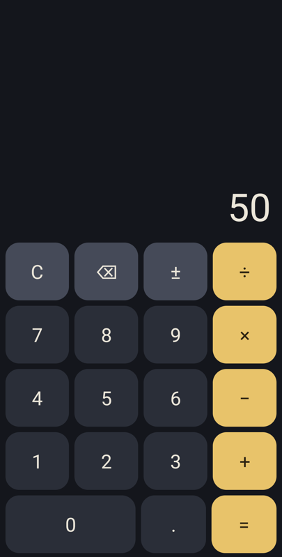

# simple_phone_calc

[How-to](https://simple-eiffel.github.io/simple_phone_calc/) •
[GitHub](https://github.com/simple-eiffel/simple_phone_calc) •
[Issues](https://github.com/simple-eiffel/simple_phone_calc/issues)


A calculator for Android, written entirely in Eiffel, with a step-by-step guide to building it yourself.

Part of the [Simple Eiffel](https://github.com/simple-eiffel) ecosystem. It shows what [simple_eif_phone](https://github.com/simple-eiffel/simple_eif_phone) can do, from an empty folder to a signed app.



## Start here

**[HOWTO.md](HOWTO.md)** takes you through every step: tools, project, contracts, tests, screen, build, debugging and signing. You write Eiffel and nothing else.

Prefer paper or a tablet? **[Download the guide as a PDF](docs/simple_phone_calc_howto.pdf)**, with diagrams and screenshots.

## Status

**1.0.0**

- 26 tests pass on the PC.
- Nine sums tapped through the real screen pass on an emulator, at the default font size and at 1.5, and on one real phone.
- The how-to was followed from an empty folder, with everything downloaded from GitHub.
- The APK is under 1 MB.

## Quick start

With the tools from the guide installed:

```
eifphone build .
eifphone run .
```

## What it shows

- Logic with no phone in it, tested on a PC
- Design by Contract on a phone, with a broken contract named in the phone's log
- A screen built from Android's own controls, in Eiffel
- One tool from source to signed APK

## License

MIT License. See the LICENSE file.
